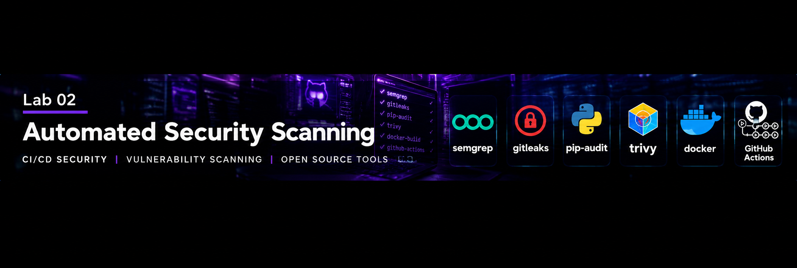

# GitHub DevSecOps Lab 2: Automated Security Scanning with GitHub Actions

**Organisation:** SkynetAI-Labs  
**Project:** DevSecOps Lab 2  
**Environment:** Ubuntu Linux, Python 3.14, Docker, GitHub Actions  
**Assessment Date:** 16 October 2026

## Project Overview

This project demonstrates automated security testing within a GitHub Actions CI/CD pipeline.

The DevSecOps security lifecycle follows:

**Identify → Analyse → Remediate → Rescan → Verify → Document**

## Security Tools

| Tool | Purpose |
|---|---|
| pytest | Automated Python application testing |
| Semgrep | Static application security testing (SAST) |
| Gitleaks | Secret detection |
| pip-audit | Python dependency vulnerability scanning |
| Trivy | Docker container vulnerability scanning |

## CI/CD Pipeline

GitHub Actions runs automated checks on repository changes.

Workflow configuration files are stored in `.github/workflows/`.

The pipeline demonstrates:

- Automated application testing
- Source-code security scanning
- Secret detection
- Dependency auditing
- Container image scanning
- Security failure enforcement

## Application and Docker

The project includes a Python demonstration application.

The current Docker image uses Python 3.14 on Alpine 3.23, applies available Alpine updates, removes runtime pip, and runs as UID 10001.

The application was tested successfully after removing pip from the runtime image.

## Initial Vulnerability Assessment

Trivy initially identified:

| Component | HIGH | CRITICAL |
|---|---:|---:|
| Debian 13.7 | 44 | 0 |
| Python libraries | 4 | 0 |
| **Total** | **48** | **0** |

The Python findings involved libraries bundled with pip:

- msgpack 1.1.2
- urllib3 2.7.0
- setuptools 70.3.0

## Security Remediation

The application was confirmed to operate without pip at runtime.

Pip and its bundled libraries were removed from the Docker image.

The Docker image was rebuilt, tested and rescanned.

## Historical Assessment After Removing Runtime Pip

| Component | HIGH | CRITICAL |
|---|---:|---:|
| Debian 13.7 | 44 | 0 |
| Python libraries | 0 | 0 |
| **Total** | **44** | **0** |

**Result:** Four HIGH Python vulnerability findings eliminated.

## Historical Debian Findings

The remaining 44 HIGH findings affect Debian operating-system packages.

A Trivy assessment using `--ignore-unfixed` identified no Debian findings with available fixes.

These findings remained in the earlier Debian image. That image has now been replaced with the Alpine runtime described below; the Debian packages themselves were not patched by this change.

The Docker image must not be considered vulnerability-free.

## GitHub Actions Verification

The Trivy GitHub Actions workflow successfully builds the container image and executes the vulnerability scan.

The workflow returns a failure status when HIGH or CRITICAL vulnerabilities are detected.

This behaviour is intentional and preserves the configured security policy.

## Security Findings Report

See the detailed [Security Findings Report](docs/SECURITY_FINDINGS.md).

The report documents:

- Initial vulnerability findings
- Vulnerable Python libraries
- Remediation actions
- Rescan results
- Historical Debian findings and subsequent base-image replacement
- CI/CD security enforcement

## Current Remediation Verification

The remediation in [pull request #2](https://github.com/SkynetAI-Labs/GitHub-DevSecOps-Lab-2-Automated-Security-Scanning-with-GitHub-Actions/pull/2) replaced the Debian runtime with Python Alpine.

Both push and pull request runs passed all five checks: application tests, Semgrep, Gitleaks, dependency auditing, and Trivy (10 successful checks in total).

The container workflow also verified the expected greeting and execution as UID 10001. Local backups, caches, and development files are excluded from the build context.

Trivy retained its HIGH/CRITICAL failure threshold and included unfixed findings. Passing means no findings triggered that policy at scan time; lower-severity findings are outside this gate. It does not establish that the image has no vulnerabilities.

## Skills Demonstrated

- Linux command-line administration
- Git and GitHub
- GitHub Actions CI/CD
- Python application testing
- Static application security testing
- Secret detection
- Dependency vulnerability analysis
- Docker image security
- Vulnerability remediation
- Security reporting

## Project Status

Security automation implemented and container scanning verified.

Four HIGH Python findings eliminated.

The replacement Alpine image passed both Trivy checks under the unchanged HIGH/CRITICAL policy, including unfixed findings.

**SkynetAI-Labs | DevSecOps Portfolio**
